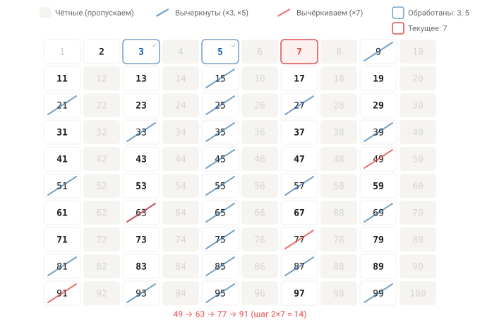
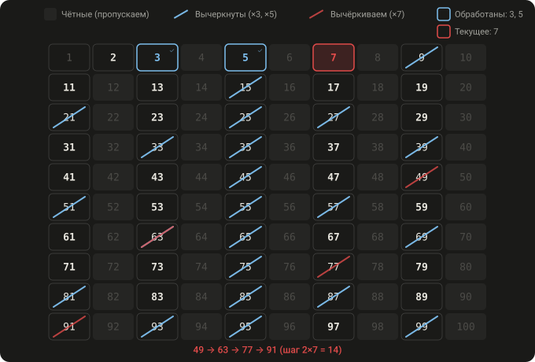
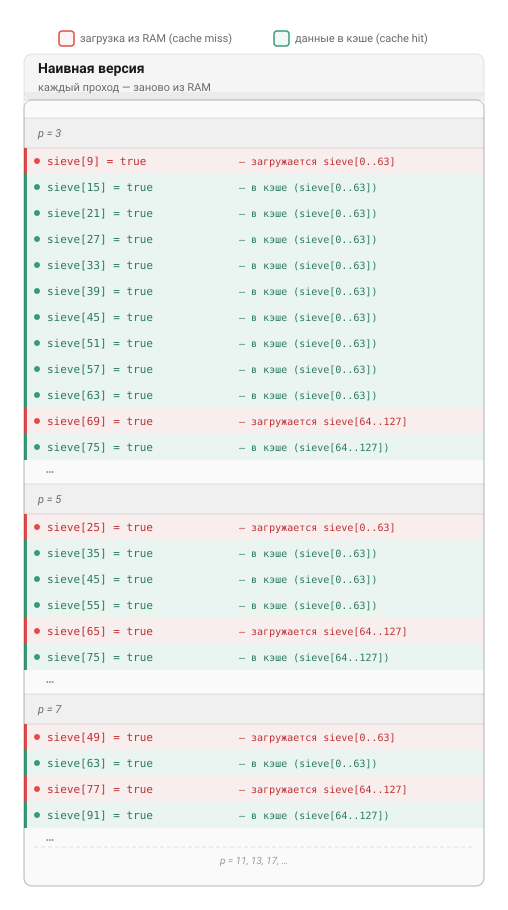
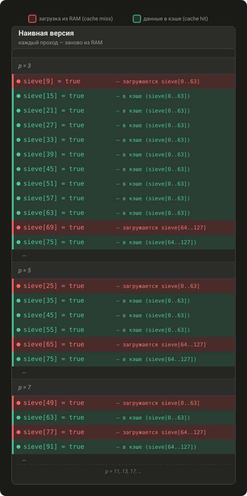
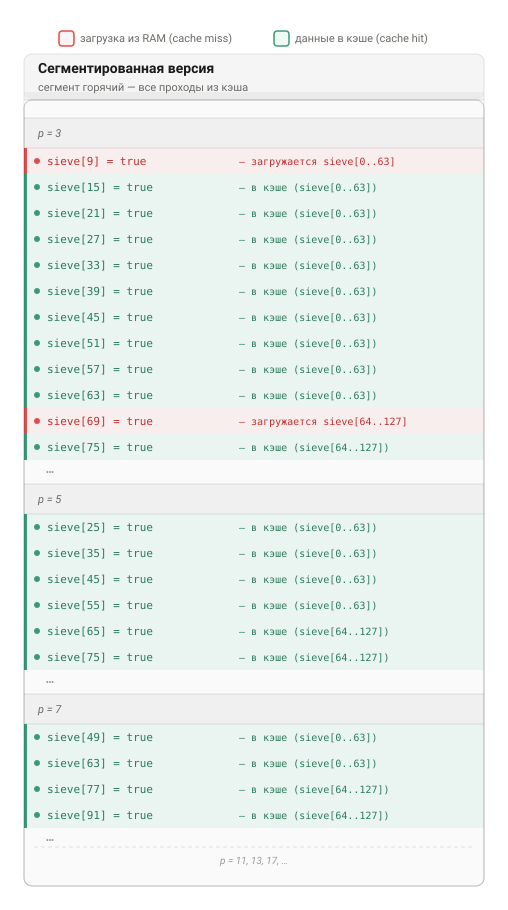
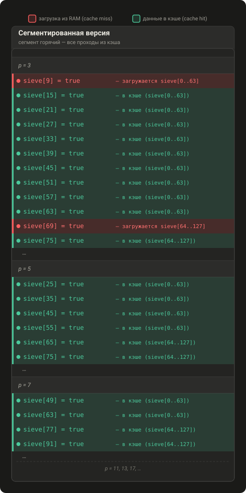
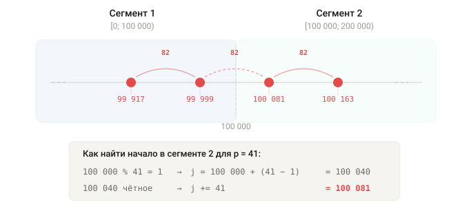
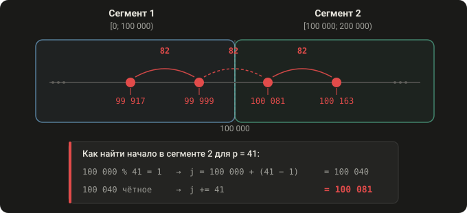

+++
title = "Оптимизация решета Эратосфена. Сегментация."
date = 2026-04-03

[taxonomies]
tags = ["rust", "algorithms"]

[extra]
katex = true
toc = true
+++

## Предыстория

В 2008 году я участвовал в соревновании по программированию, и одна из задач выглядела так:



В этой тренировочной задаче вам потребуется проверить на простоту как можно больше чисел. Чтобы не делать ее ориентированной на скорость ввода-вывода, числа будут следовать в следующем порядке: пусть первое число будет **1**, а все следующие определяются рекуррентным соотношением: 

$$a_i = (a_{i-1} + 1234567890) \mod 2^{31}$$

И будьте внимательны, не используйте для решения больше, чем **4096** байтов кода. 


### Выходные данные

Для каждого числа выведите на выход цифру **"1"**, если число простое, или цифру **"0"**, если составное.

### Начисление очков

Количество очков, полученное вашей программой, будет равно минимальному номеру позиции, на которой произошло расхождение с правильным ответом. Из-за некоторых ограничений проверяющей программы не выводите более чем **33 333 333** цифр. Если вы достигнете этого ограничения, ваш счет будет скорректирован с учетом времени выполнения программы.

### Пример

**Выходные данные:**

01000000000000000000000000001000010000000001100000

за этот вывод вы получите ровно 50 очков.


Для решения я использовал алгоритм Миллера-Рабина, и он показал достойный результат. Но наиболее эффективным оказалось решение от участника под ником **Levin Aleksey**. Автор строил решето Эратосфена, а затем для каждого числа из рекуррентной последовательности за константное время мог выяснить, является данное число простым или нет. Предлагаю познакомиться с оригинальной версией по ссылке. К ее кусочкам мы еще вернемся по ходу нашего повествования.


У программ были ограничения на размер исходника, время выполнения и объем потребляемой памяти. Так как цель этой серии статей образовательная, то мы будем игнорировать указанные лимиты для лучшей читаемости.


## Что я ожидаю от читателя

Эту статью я написал так, чтобы можно было понять все изложенное, обладая самыми базовыми знаниями. Если вы в своей жизни написали хоть одну программу и знакомы с тем, что такое сложение и умножение, то этого достаточно. Но это не означает, что будет легко.

## Что нас ждет

- в первой части мы напишем наивную версию решета Эратосфена и разберемся, что такое сегментация (эта техника позволит нам в $3.3$ раза ускорить выполнение программы)
- во второй части мы применим оптимизацию *wheel factorization*. Этот математический трюк даст нам не только ускорение в $3.8$ раз, но и существенно сократит потребление памяти (в сочетании с побитовым хранением выигрыш по памяти для решета будет $30$-кратным). Объединив эти две техники, мы получим ускорение программы в $8.6$ раз и приблизимся к оригинальному решению
- в третьей части мы сравним наше решение с оригинальным, дополнительная микрооптимизация практически уравняет две версии
- в четвертой части мы поговорим о последнем существенном отличии между нашим и оригинальным решениями
- в последующих частях мы найдем способы ускорить программу еще вдвое относительно оригинальной версии

Но, что более важно, мы на практическом примере увидим, как знание деталей работы процессора и нехитрая математика позволяют добиться выдающихся результатов.

Все исходные коды и результаты замеров вы сможете найти по ссылке.


Компилировал с такими опциями (*-O3* для оригинального решения используется, чтобы уравнять с кодом на *Rust*):
    
```sh
gcc -O3 -march=native -fwrapv -pipe -o original/solution original/main.c

RUSTFLAGS="-C target-cpu=native" cargo build --release
```

Версии компиляторов:

```sh
gcc version 15.2.1 20260214 (Gentoo 15.2.1_p20260214 p5)
rustc 1.94.0 (4a4ef493e 2026-03-02)
```

Процессор:

```
Intel Core i7-6700K

Размер кэшей для одного ядра:

L1D — 32 KiB
L2 — 256 KiB
L3 — 8 MiB
```

Перед запуском я сконфигурировал процессор в производительный режим:

```sh
for i in /sys/devices/system/cpu/cpu*/cpufreq/scaling_governor
do
    echo performance | sudo tee $i
done
```

Делал несколько запусков каждой версии, в качестве результата брал среднее время выполнения. Для автоматизации этого процесса я использовал утилиту *hyperfine*, пример использования и вывод ниже:

```sh
$ hyperfine --warmup 3 --runs 20 'taskset -c 0 original/solution > /dev/null'

Benchmark 1: taskset -c 0 original/solution > /dev/null
Time (mean ± σ):      1.067 s ±  0.003 s    [User: 1.036 s, System: 0.029 s]
Range (min … max):    1.063 s …  1.074 s    20 runs
```

В репозитории также представлены результаты запусков программ при помощи утилиты *perf* и сводная таблица с результатами.

Там же можно увидеть результаты запусков на других платформах.


## Благодарности


Я очень признателен за помощь в рецензировании данной статьи следующим людям:

- Екатерина К.


## Наивная версия решета

Решето Эратосфена позволяет найти все простые числа до некоторого предела $N$ следующим образом: 

- выпишем все числа от $2$ до $N$
- найдем первое незачеркнутое число (в нашем случае $2$), вычеркнем из списка все числа, кратные ему: $4, 6, 8, ...$
- найдем следующее незачеркнутое число (теперь $3$), вычеркнем из списка все числа, кратные ему: $6, 9, 12, ...$
- найдем следующее незачеркнутое число (теперь $5$), вычеркнем из списка все числа, кратные ему: $10, 15, 20, ...$
- ...

Отмечу, что: 

- если мы хотим вычеркнуть кратные $p$, то можно начинать не с $2p$, а с $p^2$, ведь мы вычеркнули ранее $2p,\\,3p,\\,...,\\,(p-1)p$.
- все простые — нечетные (для $p > 2$), значит $p^2$ тоже нечетное. При шаге $p$ мы бы чередовали четные и нечетные числа ($p^2,\\,p^2 + p,\\,p^2 + 2p,\\,...$), но четные нас не интересуют — они и так заведомо составные. Поэтому вычеркиваем с шагом $2p$, оставаясь на нечетных числах (для $p = 7: 49, 63, 77, 91, ...$)





Программа, реализующая данный алгоритм, может выглядеть так:

```rust
fn naive_sieve(n: usize) -> impl Fn(usize) -> bool {
    // false - prime, true - composite
    let mut sieve: Vec<bool> = vec![false; n];

    sieve[1] = true;
    for p in (3..n).step_by(2) {
        if sieve[p] {
            continue;
        }

        let step = 2 * p;
        for i in (p * p..n).step_by(step) {
            sieve[i] = true;
        }
    }

    move |a| a == 2 || (a % 2 != 0 && !sieve[a])
}
```

В массиве *sieve* мы проставляем *true* в *i*-й позиции, если число не является простым.

Вся программа отработала на моем компьютере за `12.400 сек`. Построить решето необходимо до $2^{31}$, каждый *bool* занимает $1$ байт, поэтому на массив *sieve* потребуется `2 GiB`.

## Сегментированное решето

Современные процессоры имеют несколько уровней кэшей. У настольных и серверных процессоров этих уровней обычно $3$, отличаются они между собой размером и скоростью доступа. Предназначены кэши для ускорения **повторного** чтения тех же или "близлежащих" данных.

Работает это следующим образом. Допустим, программе требуется прочитать данные из оперативной памяти. Процессор загружает их блоками по $64$ байта (размер *cache line*). Эти блоки "оседают" на разных уровнях кэшей (на каких именно — зависит от архитектуры процессора). Если мы обращаемся к данным по тому же адресу или в пределах загруженных $64$ байт, то повторное обращение к оперативной памяти не требуется.

<details>
    <summary>Размеры кэшей процессора intel-i7-6700K</summary>


Для тестов я использую компьютер с процессором *intel-i7-6700K*, вот какими характеристиками он обладает:

| Тип                  | Размер            | Скорость доступа, в циклах процессора |
| -------------------- | ----------------- | ------------------------------------- |
| Кэш *L1D*            | 32 KiB            | 4 — 5                                 |
| Кэш *L2*             | 256 KiB           | 12                                    |
| Кэш *L3*             | 8 MiB             | 42                                    |
| Оперативная память   | от 8 GiB          | ≈ 227                                 |

Скорость доступа к оперативной памяти я измерял при помощи *Intel Memory Latency Checker* при частоте процессора $4.2$ GHz.

Чтобы получить время доступа в секундах, нужно разделить количество циклов на частоту процессора, например, до *L2* мы будем доступаться за $t = 12 / (4.2 \cdot 10^9) \approx 2.86$ наносекунды.

</details>

Теперь давайте подумаем, что наша наивная версия делает:

- для $p = 3$, каждое число из интервала $[9; 2^{31})$ с шагом $step = 2 \cdot 3$ помечаем как составное: $9, 15, 21, ...$
- для $p = 5$, каждое число из интервала $[25; 2^{31})$ с шагом $step = 2 \cdot 5$ помечаем как составное: $25, 35, 45, ...$
- для $p = 7$, каждое число из интервала $[49; 2^{31})$ с шагом $step = 2 \cdot 7$ помечаем как составное: $49, 63, 77, ...$
- ...




Для **каждого** простого $p$ мы заново читаем данные из оперативной памяти, ведь предыдущие *sieve[0..63]*, *sieve[64..127]*, ... были **вытеснены** из кэша процессора, так как его размер гораздо меньше, чем объем загруженного. Было бы здорово использовать кэш более эффективно.

Для этого разделим все решето на кусочки размером $100\ 000$ байт и обработаем каждый кусочек отдельно:

<details>
    <summary>Почему именно 100 000?</summary>

В последующих частях мы будем сравнивать наши версии с оригинальным решением. Автор оригинального решения использовал именно такой размер сегмента, и мы пока что последуем его примеру. К слову, сегменты такого размера должны гарантированно помещаться в кэш второго уровня *L2* на моем компьютере.

</details>

- для первого сегмента $[0; 100\ 000)$
  - вычеркнем все кратные $3$
  - вычеркнем все кратные $5$
  - вычеркнем все кратные $7$
  - ...
  - вычеркнем все кратные $46337$

- для второго сегмента $[100\ 000; 200\ 000)$
  - вычеркнем все кратные $3$
  - вычеркнем все кратные $5$
  - вычеркнем все кратные $7$
  - ...
  - вычеркнем все кратные $46337$

- для каждого следующего сегмента проделываем то же, что и выше

<details>
<summary>Почему вычеркиваем до 46337?</summary>

Почему достаточно вычеркивать кратные только простых до $\sqrt{N}$? Допустим, число $n \le N$ составное. Тогда $n = a \cdot b$, где $a, b > 1$. Оба множителя не могут одновременно быть больше $\sqrt{N}$, ведь тогда $a \cdot b >\sqrt{N} \cdot \sqrt{N} = N$. Значит, хотя бы одно из них $\le \sqrt{N}$. Раз у любого составного числа есть делитель $\le \sqrt{N}$, то нам достаточно просеять кратные всех простых до $\sqrt{N}$.

Для нашей задачи $\sqrt{2^{31}} \approx 46340.95$, так что нам нужны все простые до $46340$. Наибольшее из них — $46337$.

</details>

Рассмотрим на примере самого первого сегмента, как будет использоваться кэш процессора: 




В такой реализации после первого прохода ($p = 3$) данные сегмента будут в кэше, и каждый последующий проход не будет требовать повторного обращения к оперативной памяти.


Обратите внимание, наша программа на этапе просеивания решета преимущественно записывает данные, а не считывает. Как же так получается, что кэш процессора ее ускоряет? Дело в том, что процессор работает с блоками по $64$ байта, и для записи даже одного байта требуется прочитать весь блок, изменить этот байт и записать весь блок. То есть каждая операция записи требует неявного чтения.


Код сегментированной версии станет сложнее, ведь теперь нам нужно обработать все решето по кусочкам. Для каждого простого нужно будет посчитать, с какого именно числа мы начнем вычеркивать в определенном сегменте. Как это сделать, я проиллюстрировал ниже на примере простого $p = 41$: 




А так будет выглядеть эта логика в виде кода:

```rust
const CHUNK: usize = 100_000;

fn segmented_sieve(n: usize) -> impl Fn(usize) -> bool {
    let sqrt_n = (n as f64).sqrt() as usize + 1;
    let is_prime = naive_sieve(sqrt_n);
    let small_primes: Vec<usize> =
        (3..sqrt_n)
            .filter(|&i| is_prime(i))
            .collect();

    let mut sieve: Vec<bool> = vec![false; n];
    sieve[1] = true;

    for chunk_start in (0..n).step_by(CHUNK) {
        let chunk_end = (chunk_start + CHUNK).min(n);

        for &p in &small_primes {
            if p * p > chunk_end {
                break;
            }

            let r = chunk_start % p;
            let mut j = match r {
                0 => chunk_start,
                _ => chunk_start + p - r,
            };
            if j % 2 == 0 {
                j += p;
            }

            j = j.max(p * p);

            let step = 2 * p;
            for j in (j..chunk_end).step_by(step) {
                sieve[j] = true;
            }
        }
    }

    move |a| a == 2 || (a % 2 != 0 && !sieve[a])
}
```

Здесь мы сначала предвычисляем (при помощи наивной версии) все простые до $\lfloor \sqrt{2^{31}} \rfloor = 46340$ — назовем их *малые простые*. А дальше обходим каждый сегмент, вычеркивая кратные всех *малых простых*:

- в первом сегменте:
	- для $p = 3$, каждое число из интервала $[9; 100\ 000)$ с шагом $2 \cdot 3$ помечаем как составное: $9, 15, 21, ...$
	- для $p = 5$, каждое число из интервала $[25; 100\ 000)$ с шагом $2 \cdot 5$ помечаем как составное: $25, 35, 45, ...$
	- для $p = 7$, каждое число из интервала $[49; 100\ 000)$ с шагом $2 \cdot 7$ помечаем как составное: $49, 63, 77, ...$
	- ...
- во втором сегменте
	- для $p = 3$, каждое число из интервала $[100\ 000; 200\ 000)$ с шагом $2 \cdot 3$ помечаем как составное (сначала позиционируем на кратное $3$)
	- для $p = 5$, каждое число из интервала $[100\ 000; 200\ 000)$ с шагом $2 \cdot 5$ помечаем как составное (сначала позиционируем на кратное $5$)
	- для $p = 7$, каждое число из интервала $[100\ 000; 200\ 000)$ с шагом $2 \cdot 7$ помечаем как составное (сначала позиционируем на кратное $7$)
	- ...
- ... 


Вся программа отработала на моем компьютере за `3.735 сек`. Потребление памяти под решето осталось таким же, как и в наивной версии. Исходный код можно посмотреть здесь.

<div class="table-wrapper">

| Версия                 | Время            |  Ускорение | Оптимизации                      |
| ---------------------- | ---------------- |  --------- | -------------------------------- |
| naive                  | 12.400 сек       | 1x         | -                                |
| segmented              | 3.735 сек        | 3.3x       | сегментация                      |

</div>

## Что дальше

В следующей части мы освоим оптимизацию *wheel factorization*. Объединив эту технику с представленной здесь сегментацией, мы ускорим программу в $8.6$ раза и уменьшим потребление памяти в $30$ раз.
